# Comprehensive Frontend UI Consistency Audit: Desktop & Mobile

## Executive Summary

This audit provides a complete, evidence-based inventory of UI inconsistencies across the entire boardroute.com frontend. The desktop landing view (canvas, topbar, sidebars, and canvas toolbar) has been identified as the canonical standard: users appreciate its sleek dark aesthetic, subtle glassmorphism, Outfit typography, and compact density.

However, across the application's dialogs, overlays, sub-menus, and toolbars, the interface has grown organically. Elements that serve identical purposes have developed fragmented styling, conflicting dimensions, arbitrary border radii, and divergent interaction patterns.

This document analyzes every component across the frontend, provides visual proof via 12 contact sheets under `docs/ui/sheets/`, examines interaction states and UX wording, documents discovered bugs with visual evidence under `docs/ui/bugs/`, establishes the canonical standard, and outlines a phased modularization plan.

---

## 1. Component Coverage & Architectural Findings

Every component across the repository was audited:
1. `src/components/Topbar.jsx` (Contains **2 separate style blocks**: main topbar styling at lines 205–740, and `.coach-mark` styling at lines 752–798).
2. `src/components/SidebarLeft.jsx` (Circuit management, JSON drawer, parts list, component cards).
3. `src/components/SidebarRight.jsx` (Board statistics, component inspector, net list, and embedded `BoardSettingsStyles`).
4. `src/components/PcbCanvas.jsx` (Canvas viewport, multi-touch gestures, floating canvas toolbar).
5. `src/components/ProcessingBar.jsx` (Optimization bar with metrics, progress track, preview, and mode variants).
6. `src/components/ResultCard.jsx` (Wired/compacted summary notification card with action buttons).
7. `src/components/ExamplesOverlay.jsx` (Circuit template picker dialog).
8. `src/components/LibraryOverlay.jsx` (Component catalog dialog with search, category chips, and photo CTA).
9. `src/components/CompEditorOverlay.jsx` (Component footprint and pin editor).
10. `src/components/PhotoFootprintOverlay.jsx` (Computer-vision photo footprint generator; branch `test/combined-21-22`).
11. `src/components/ExportOverlay.jsx` (Export format selector, image generator, and embedded `BoardCard`).
12. `src/components/BoardSettings.jsx` (Physical board dimensions, hole labelling, and origin selectors; exports `BoardSettingsStyles`).
13. `src/components/PromptOverlay.jsx` (AI circuit generator prompt modal).
14. `src/components/ConfirmOverlay.jsx` (Workspace reset confirmation modal).
15. `src/components/FastTooltips.jsx` (Global 150ms tooltip injector, portalled to `document.body`).
16. Explainer Pages (`scripts/site.css` and `scripts/build-site.js` for `/how-it-works/`).
17. Root Shell (`src/index.css` and `src/App.jsx`).

### Key Architectural Discovery: Scattered `<style>` Blocks
There is no single source of truth for component styles. Instead, **16 `<style dangerouslySetInnerHTML>` blocks** are scattered across JSX files. Styles are repeatedly injected into the DOM on every render. Design tokens in `src/index.css` are bypassed in favor of hardcoded pixel sizes and arbitrary `rgba(...)` color strings.

---

## 2. Visual Evidence: The 12 Category Contact Sheets

All variants within each category were cropped from live desktop renders and assembled into 12 annotated contact sheets located in `docs/ui/sheets/`.

### Category 1: Buttons (`docs/ui/sheets/buttons.png`)
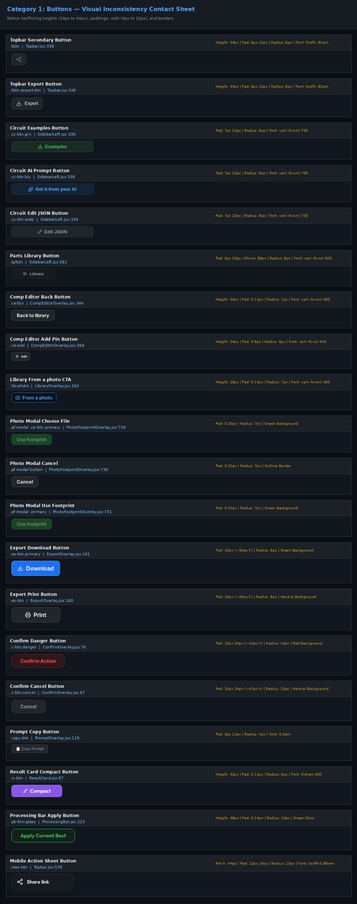

At least **16 distinct button classes and button implementations** exist with conflicting heights, paddings, and radii:
- `.tbtn` (`Topbar.jsx:338`): Height 34px, padding 6px 12px, radius 8px, font Outfit .82em.
- `.flow-btn` (`Topbar.jsx:367`): Height 34px, min-width 90px, radius 8px with custom chevron clip-path.
- `.mas-btn` (`Topbar.jsx:578`): Min-height 44px, padding 12px 14px, radius 10px, font Outfit 0.88rem.
- `.cc-btn.grn` & `.cc-btn.blu` (`SidebarLeft.jsx:336, 338`): Variable height, padding 7px 10px, radius 8px, font var(--fs-sm) 700.
- `.tplbtn` (`SidebarLeft.jsx:561`): Padding 6px 10px, min-width 80px, radius 8px, font var(--fs-xs) 600.
- `.ce-btn` (`CompEditorOverlay.jsx:344`): Height 30px, padding 0 14px, radius 7px, font var(--fs-sm) 600.
- `.ce-add` (`CompEditorOverlay.jsx:368`): Height 24px, padding 0 8px, radius 6px, font var(--fs-xs) 600.
- `.lib-photo` (`LibraryOverlay.jsx:163`): Height 28px, padding 0 10px, radius 7px, font var(--fs-sm) 600.
- `.ex-btn.primary` & `.ex-btn` (`ExportOverlay.jsx:160, 161`): Height ~40px, padding 10px, radius 8px.
- `.c-btn.danger` & `.c-btn.cancel` (`ConfirmOverlay.jsx:55-76`): Height ~42px, padding 10px 24px, radius 10px, font Inter 0.85em 700.
- `.copy-btn` (`PromptOverlay.jsx:119`): Padding 6px 12px, radius 4px, font 0.9em.
- `.rc-btn` (`ResultCard.jsx:87`): Height 32px, padding 0 12px, radius 6px, font 0.8rem 600.
- `.pb-btn-glass` (`ProcessingBar.jsx:223`): Height 38px, padding 0 24px, radius 10px, font Outfit 0.9rem 700.
- `.bv-mini` (`BoardSettings.jsx:177`): Padding 3px 8px, radius 6px, font var(--fs-xs) 700.
- `.examples-skip` (`ExamplesOverlay.jsx:53`): Padding 10px 18px, radius 8px, font var(--fs-sm).

### Category 2: Icon Buttons (`docs/ui/sheets/icon_buttons.png`)
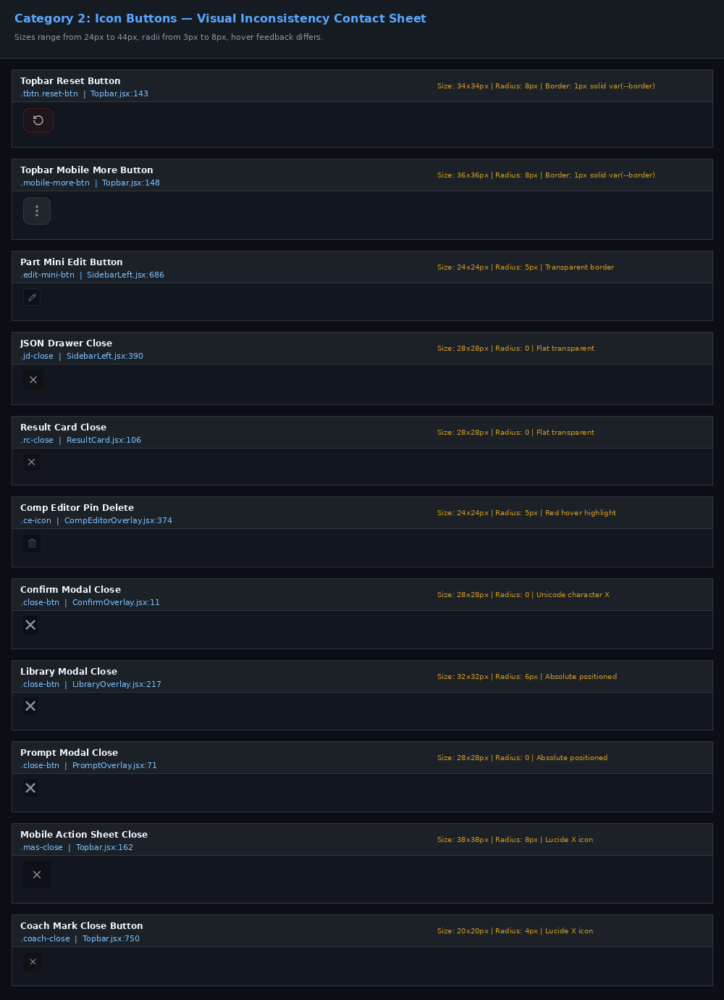

Icon button dimensions vary from 20px to 44px, and their corner treatments range from square to round:
- `.tbtn.reset-btn` (`Topbar.jsx:143`): 34px × 34px, radius 8px, 1px solid var(--border).
- `.mobile-more-btn` (`Topbar.jsx:148`): 36px × 36px, radius 8px.
- `.canvas-btn` (`PcbCanvas.jsx:217`): 38px × 38px on desktop (radius 6px), 44px × 44px on mobile (radius 8px).
- `.edit-mini-btn` (`SidebarLeft.jsx:686`): 24px × 24px, radius 5px.
- `.jd-close` (`SidebarLeft.jsx:390`): 28px × 28px, borderless transparent, inline SVG.
- `.rc-close` (`ResultCard.jsx:106`): 28px × 28px, borderless transparent.
- `.ce-icon` (`CompEditorOverlay.jsx:374`): 24px × 24px, radius 5px, red hover highlight.
- `.close-btn` (`ConfirmOverlay.jsx:11`, `PromptOverlay.jsx:71`): 28px × 28px, unicode `✕` text glyph instead of SVG icon.
- `.close-btn` (`LibraryOverlay.jsx:217`): 32px × 32px, radius 6px, absolute positioned at `top: 14px; right: 14px`.
- `.mas-close` (`Topbar.jsx:162`): 38px × 38px, radius 8px, Lucide `<X size={18} />`.
- `.coach-close` (`Topbar.jsx:750`): 20px × 20px, radius 4px, Lucide `<X size={13} />`.
- `.bv-corner` (`BoardSettings.jsx:98`): 14px × 14px, radius 3px.

### Category 3: Segmented Controls (`docs/ui/sheets/segmented_controls.png`)
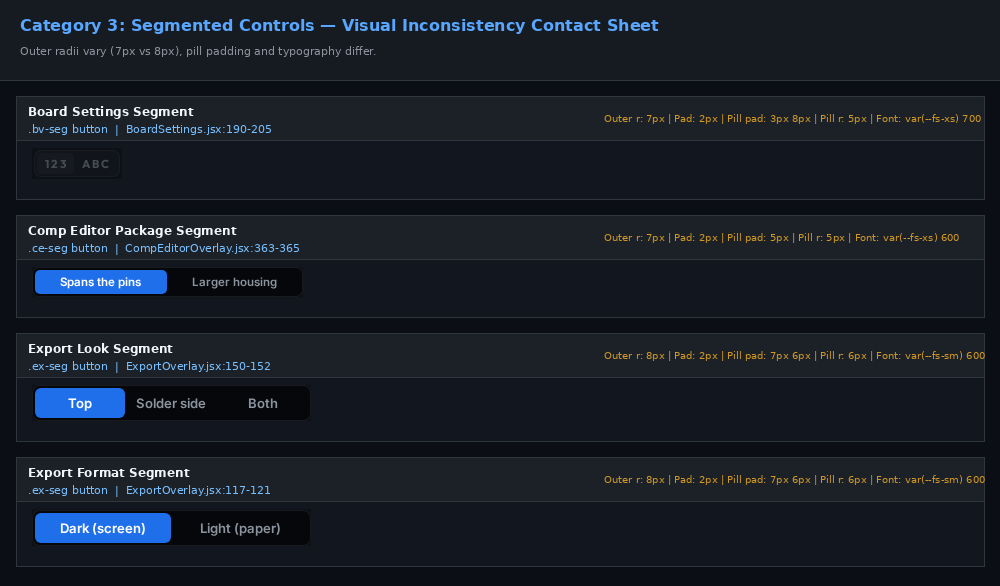

Segmented radio groups are implemented in three completely separate files with different padding and outer/inner radius ratios:
- `.bv-seg` (`BoardSettings.jsx:190-205`): Outer radius 7px, padding 2px; pill padding 3px 8px, pill radius 5px; font `var(--fs-xs) 700`.
- `.ce-seg` (`CompEditorOverlay.jsx:363-365`): Outer radius 7px, padding 2px; pill padding 5px, pill radius 5px; font `var(--fs-xs) 600`.
- `.ex-seg` (`ExportOverlay.jsx:150-152`): Outer radius 8px, padding 2px; pill padding 7px 6px, pill radius 6px; font `var(--fs-sm) 600`.

### Category 4: Inputs & Textareas (`docs/ui/sheets/inputs.png`)
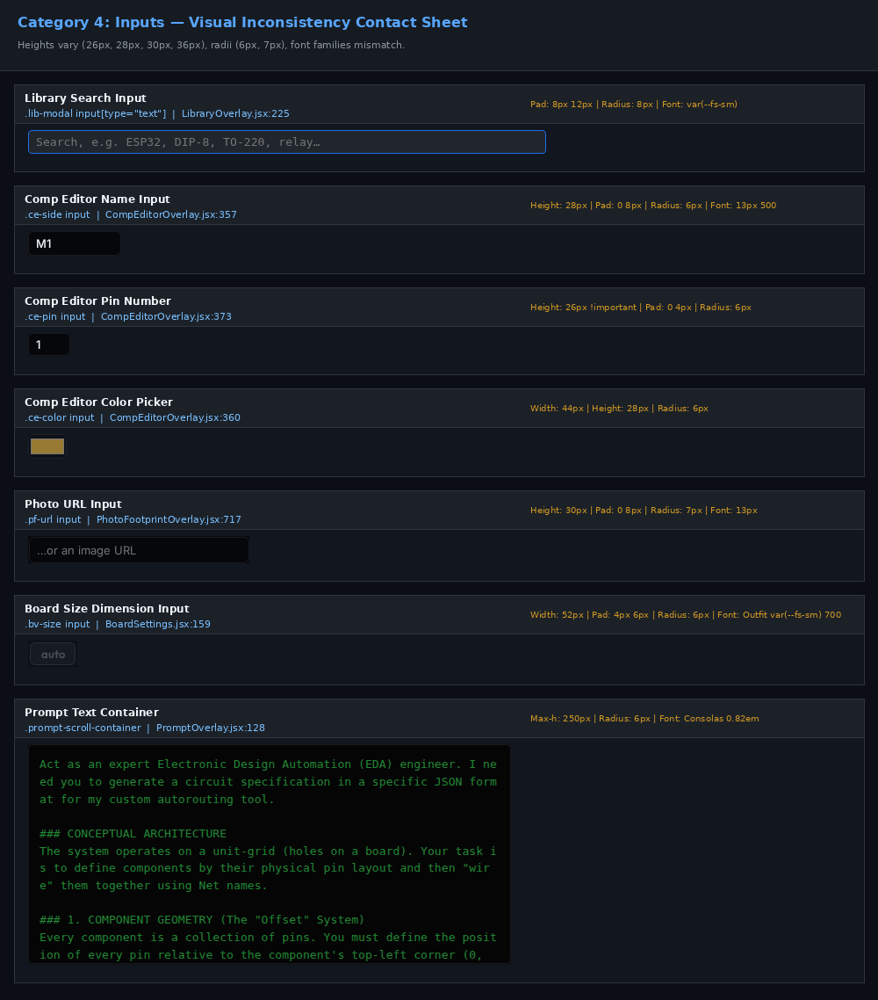

Input fields have mismatched vertical heights (26px, 28px, 30px, 34px), differing inner paddings, and inconsistent fonts:
- `.bv-size input` (`BoardSettings.jsx:159`): Width 52px, padding 4px 6px, radius 6px, font Outfit var(--fs-sm) 700, centered text.
- `.lib-modal input[type="text"]` (`LibraryOverlay.jsx:225`): Full width, padding 8px 12px, radius 8px, font var(--fs-sm).
- `.ce-side input:not([type=color])` (`CompEditorOverlay.jsx:357`): Height 28px, padding 0 8px, radius 6px, font 13px 500.
- `.ce-pin input` (`CompEditorOverlay.jsx:373`): Height 26px !important, padding 0 4px, radius 6px.
- `.ce-color input` (`CompEditorOverlay.jsx:360`): Width 44px, height 28px, radius 6px, native color swatch.
- `.pf-url input` (`PhotoFootprintOverlay.jsx:717`): Height 30px, padding 0 8px, radius 7px, font 13px.
- `.prompt-scroll-container` (`PromptOverlay.jsx:128`): Monospaced code box, background `#050505`, radius 6px, font Consolas 0.82em.
- `.jd-editor textarea` (`SidebarLeft.jsx:410`): Padding 12px, radius 0, font JetBrains Mono 0.8rem.

### Category 5: Selects & Dropdowns (`docs/ui/sheets/selects.png`)
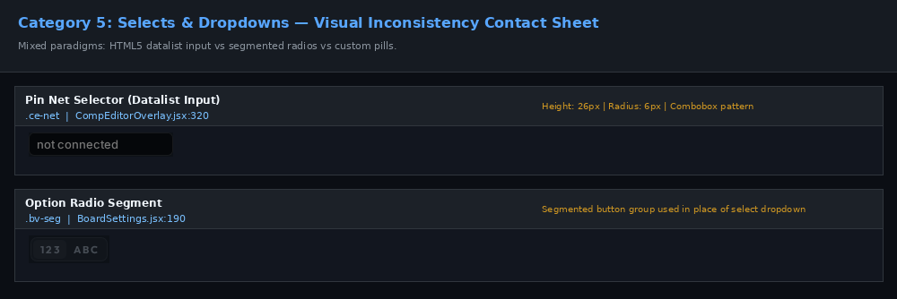

There is no standard `<Select>` component:
- CompEditor uses an `<input list="ce-nets">` HTML5 datalist element (`.ce-net`, line 320), which renders browser-dependent native popups with poor keyboard ergonomics.
- BoardSettings uses segmented buttons (`.bv-seg`) in place of select menus.

### Category 6: Checkboxes & Switches (`docs/ui/sheets/checkboxes.png`)
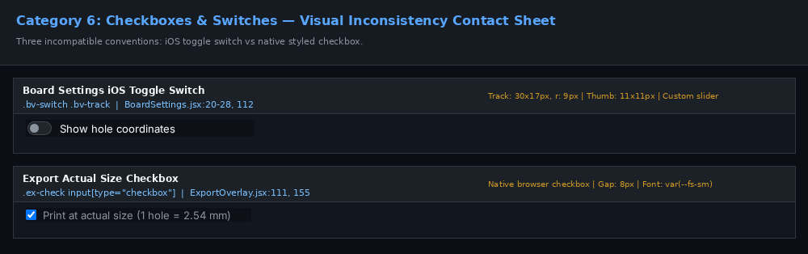

Three conflicting conventions represent boolean toggle options:
- `.bv-switch` (`BoardSettings.jsx:20-28, 112`): An iOS-style pill slider (`.bv-track` 30px × 17px, radius 9px; `.bv-thumb` 11px circle).
- `.ex-check` (`ExportOverlay.jsx:111, 155`): A raw browser checkbox with label, gap 8px, font `var(--fs-sm)`.
- `.pf-check` (`PhotoFootprintOverlay.jsx:738`): A raw browser checkbox with label, gap 6px, font `var(--fs-sm)`.

### Category 7: Dialog Headers (`docs/ui/sheets/dialog_headers.png`)
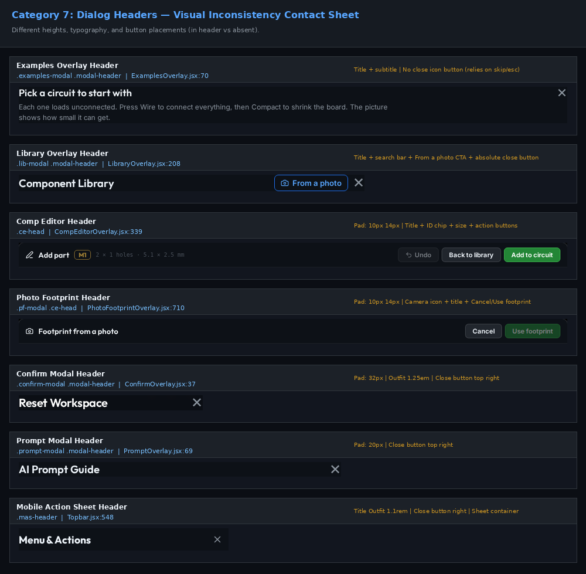

Header layouts follow completely different patterns:
- `ExamplesOverlay.jsx:70`: Title + subtitle; NO close button (only Escape / skip).
- `LibraryOverlay.jsx:208`: Title + search input + "From a photo" CTA button + absolute close button.
- `CompEditorOverlay.jsx:339`: Header height 50px; contains Title + ID chip + dimensions + "Undo" + "Back to library" + "Add to circuit" action buttons.
- `PhotoFootprintOverlay.jsx:710`: Header height 50px; contains Camera icon + Title + "Cancel" + "Use footprint" action buttons.
- `ConfirmOverlay.jsx:37`: Padding 32px; large Outfit 1.25em heading + text glyph close button.
- `PromptOverlay.jsx:69`: Padding 20px; heading + text glyph close button.
- `Topbar.jsx:548`: Mobile action sheet header with Outfit 1.1rem title + Lucide close button.

### Category 8: Dialog Footers & Action Rows (`docs/ui/sheets/dialog_footers.png`)
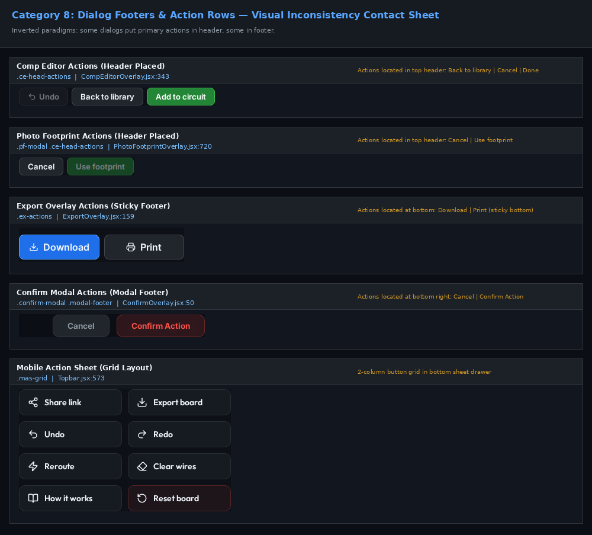

Primary action placement is fundamentally split:
- **Header-Placed Actions**: `CompEditorOverlay` and `PhotoFootprintOverlay` put their primary submission buttons ("Add to circuit", "Use footprint") in the top header.
- **Sticky Footer Actions**: `ExportOverlay` places "Download" and "Print" in a sticky bottom footer.
- **Modal Footer Actions**: `ConfirmOverlay` places "Cancel" and "Confirm Action" in the bottom right.
- **Single CTA Footer**: `PromptOverlay` uses a single full-width button; `ExamplesOverlay` uses a single centered skip button.

### Category 9: Section Labels & Headers (`docs/ui/sheets/section_labels.png`)
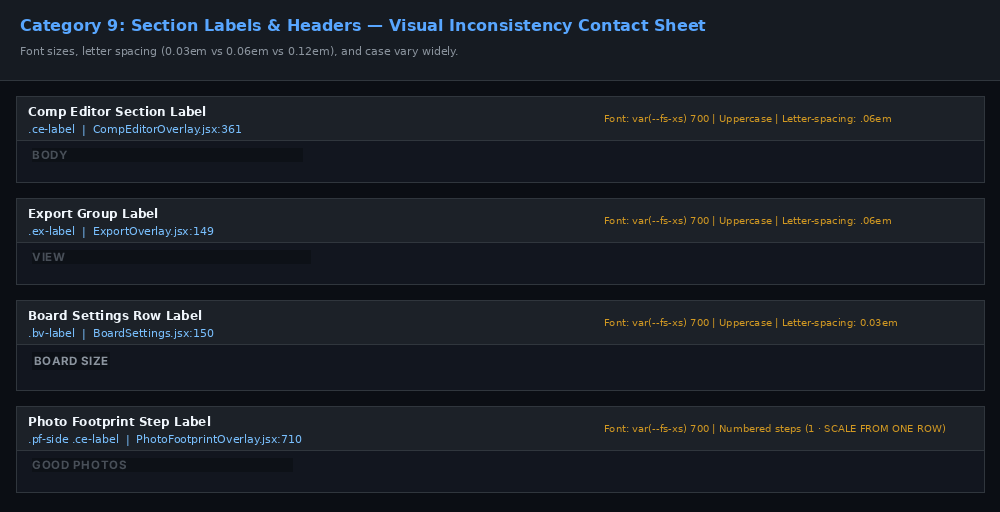

Typography, letter-spacing, and casing vary without reason:
- `.s-title` (`SidebarLeft.jsx:265`): Font `var(--fs-md) 700`, icon size 16px, sentence case.
- `.ce-label` (`CompEditorOverlay.jsx:361`): Font `var(--fs-xs) 700`, uppercase, letter-spacing `0.06em`.
- `.ex-label` (`ExportOverlay.jsx:149`): Font `var(--fs-xs) 700`, uppercase, letter-spacing `0.06em`.
- `.bv-label` (`BoardSettings.jsx:150`): Font `var(--fs-xs) 700`, uppercase, letter-spacing `0.03em`.
- `.stat-label` (`SidebarRight.jsx:220`): Font `0.65rem 800`, uppercase, letter-spacing `0.12em`.
- `.net-header` (`SidebarRight.jsx:260`): Font `var(--fs-sm) 700`, sentence case.
- `.pf-side .ce-label` (`PhotoFootprintOverlay.jsx:710`): Numbered uppercase step headers (`1 · SCALE FROM ONE ROW`).

### Category 10: Hints & Helper Texts (`docs/ui/sheets/hints.png`)
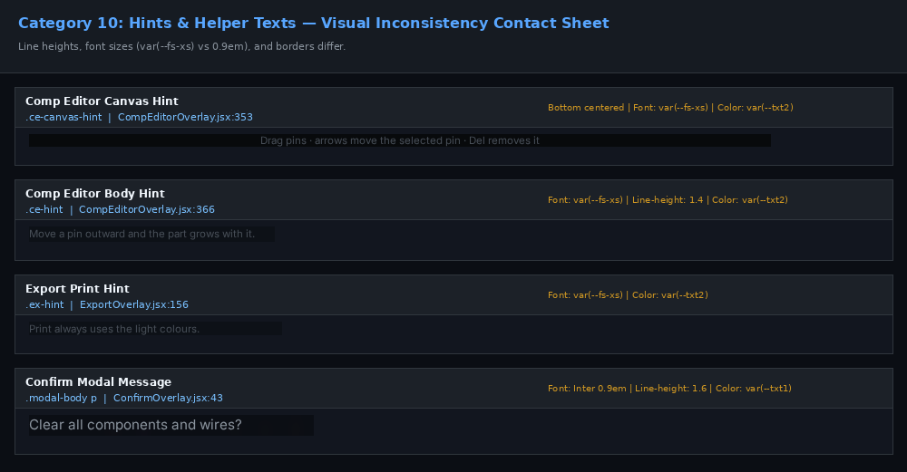

Helper notes vary in font sizes, line heights, and styling:
- `.ce-canvas-hint` (`CompEditorOverlay.jsx:353`): Absolute bottom, font `var(--fs-xs)`, color `var(--txt2)`.
- `.ce-hint` (`CompEditorOverlay.jsx:366`): Font `var(--fs-xs)`, line-height 1.4, color `var(--txt2)`.
- `.ex-hint` (`ExportOverlay.jsx:156`): Font `var(--fs-xs)`, color `var(--txt2)`.
- `.bv-note` (`BoardSettings.jsx:74`): Background `transparent`, font `var(--fs-xs)`.
- `.bv-note.warn` (`BoardSettings.jsx:66`): Amber background `rgba(210, 153, 34, 0.1)`, amber border, alert icon.
- `.modal-body p` (`ConfirmOverlay.jsx:43`): Font Inter 0.9em, line-height 1.6, color `var(--txt1)`.

### Category 11: Cards & Chips (`docs/ui/sheets/cards_chips.png`)
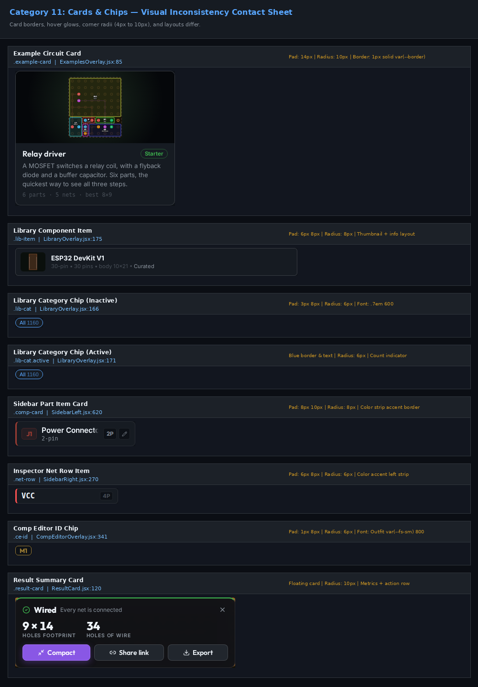

Cards exhibit inconsistent padding (6px to 14px), corner radii (4px to 10px), and hover styles:
- `.example-card` (`ExamplesOverlay.jsx:85`): Radius 10px, padding 14px, border `var(--border)`.
- `.lib-item` (`LibraryOverlay.jsx:175`): Radius 8px, padding 6px 8px, background `var(--bg3)`.
- `.lib-cat` (`LibraryOverlay.jsx:166`): Radius 6px, padding 3px 8px, font `.7em 600`.
- `.comp-card` (`SidebarLeft.jsx:620`): Radius 8px, padding 8px 10px, left border accent line.
- `.stat-card` (`SidebarRight.jsx:200`): Radius 8px, padding 10px, large numeric display Outfit 1.6rem.
- `.net-row` (`SidebarRight.jsx:270`): Radius 6px, padding 6px 8px, left color dot and border strip.
- `.ce-id` (`CompEditorOverlay.jsx:341`): Radius 6px, padding 1px 8px, font Outfit `var(--fs-sm) 800`.
- `.board-card` (`BoardSettings.jsx:39`): Container card with padding 0, gap 8px.
- `.result-card` (`ResultCard.jsx:120`): Radius 10px, glassmorphic backdrop filter, floating card.

### Category 12: Tooltips & Toasts (`docs/ui/sheets/tooltips_toasts.png`)
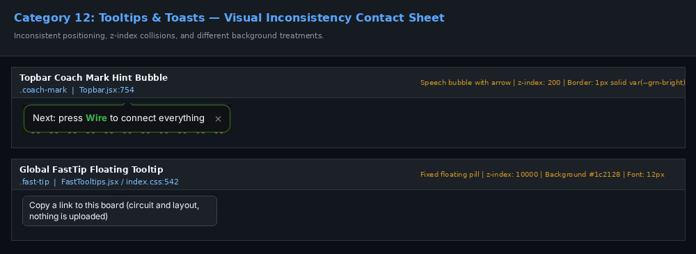

Two competing overlay feedback systems exist:
- `.coach-mark` (`Topbar.jsx:754-790`): Fixed speech bubble with animated pointer arrow, `z-index: 200`, portalled to `document.body`.
- `.fast-tip` (`FastTooltips.jsx / index.css:542`): Floating tooltip, `z-index: 10000`, 150ms delay, dark gray pill `#1c2128`.

---

## 3. Interaction States Audit: Hover, Focus, Active, Disabled, Loading

A comprehensive inspection of CSS rules reveals significant gaps in interactive states, particularly around keyboard accessibility (`:focus-visible`):

| Button / Control Class | `:hover` State | `:focus-visible` State | `:active` / Pressed | `:disabled` State | Loading Indicator |
| :--- | :--- | :--- | :--- | :--- | :--- |
| `.tbtn` (Topbar) | Yes (translateY(-1px), shadow) | **MISSING** (No outline) | Yes (translateY(0)) | Yes (opacity: 0.4) | No |
| `.flow-btn` (Workflow) | Yes (glow drop-shadow) | **MISSING** | Yes (scale: 0.98) | Yes (opacity: 0.35) | Yes (`.running` pulse) |
| `.cc-btn` (SidebarLeft) | Yes (border highlight) | **MISSING** | **MISSING** | **MISSING** | No |
| `.tplbtn` (Library/New) | Yes (border-color: blu) | **MISSING** | **MISSING** | **MISSING** | No |
| `.ce-btn` (CompEditor) | Yes (border-color: txt2) | **MISSING** | **MISSING** | Yes (opacity: 0.45) | No |
| `.ce-btn.primary` | Yes (background: #2a9a40) | **MISSING** | **MISSING** | Yes (opacity: 0.45) | No |
| `.ex-btn` (Export) | Yes (background: bg3) | **MISSING** | **MISSING** | Yes (opacity: 0.4) | No |
| `.c-btn` (Confirm) | Yes (scale / shadow) | **MISSING** | Yes (scale: 0.98) | **MISSING** | No |
| `.pb-btn-glass` | Yes (glow & translate) | **MISSING** | Yes (translateY(0)) | Yes (opacity: 0.45) | No |
| `.canvas-btn` | Yes (border highlight) | **MISSING** | Yes (background: bg4) | Yes (opacity: 0.4) | No |
| `.bv-switch input` | Yes | **PRESENT** (outline: 2px solid blu) | **MISSING** | Yes (opacity: 0.4) | No |
| `.bv-seg button` | Yes (color: txt0) | **MISSING** | **MISSING** | Yes (opacity: 0.5) | No |
| `.copy-btn` (Prompt) | Yes (background: bg3) | **MISSING** | **MISSING** | **MISSING** | No |
| `.mas-btn` (Mobile) | Yes (background: bg4) | **MISSING** | Yes (background: bg4) | Yes (opacity: 0.45) | No |

### Key State Deficiencies:
1. **Focus Accessibility**: Almost all buttons completely lack a `:focus-visible` state. Only `.bv-switch` has an explicit focus outline. Users navigating via keyboard Tab have no visible focus indicator.
2. **Press / Active Feedback**: `.ce-btn`, `.ex-btn`, `.cc-btn`, and `.tplbtn` do not have an `:active` state. They feel stiff on touch screens and mouse clicks.
3. **Disabled States**: Several buttons (`.cc-btn`, `.copy-btn`, `.c-btn`) have no `:disabled` styling defined in CSS.

---

## 4. UX Consistency: Wording, Placement, and Dialog Behaviors

### 4.1 Label Capitalization and Action Verbs
Action verbs across dialogs have evolved inconsistently:
- **Confirmation / Apply**:
  - CompEditor: `"Add to circuit"` (was `"Done"` in earlier iterations).
  - PhotoFootprint: `"Use footprint"`.
  - JSON Drawer: `"Load circuit"`.
  - ProcessingBar: `"Apply Current Best"`.
  - ConfirmModal: `"Confirm Action"`.
  - PromptModal: `"I understand, let me copy the prompt"`.
- **Cancellation**:
  - CompEditor: `"Back to library"` (closes editor, re-opens library) vs `"Cancel"`.
  - PhotoFootprint: `"Cancel"`.
  - ConfirmModal: `"Cancel"`.
  - ExamplesModal: `"Skip, I'll describe my own circuit"`.
- **Inconsistency**: Title Case (`"Use Footprint"` vs `"Use footprint"`; `"Add to circuit"` vs `"Apply Current Best"`).

### 4.2 Primary vs Secondary Action Placement
- In `CompEditorOverlay` and `PhotoFootprintOverlay`, actions are positioned in the **header** (top-right).
- In `ConfirmOverlay` and `ExportOverlay`, actions are positioned in the **footer** (bottom-right).
- In `PromptOverlay`, there is only a single full-width button at the bottom.
- In `ExamplesOverlay`, the skip button is centered at the bottom.

### 4.3 Icon + Text vs Text-Only Conventions
- `.tbtn` in Topbar: Icon + Text (`<Share2 size={16} /> Share`).
- `.flow-btn` in Topbar: Icon + Text (`<Cable size={16} /> Wire`).
- `.ce-btn` in CompEditor: Text only (`"Add to circuit"`), except `.ce-undo` which has an icon.
- `.ex-btn` in Export: Icon + Text (`<Download size={16} /> Download`).
- `.c-btn` in Confirm: Text only (`"Confirm Action"`).

### 4.4 Close Button & Modal Dismissal Behaviors
| Dialog Overlay | Top-Right Close Button | `Escape` Key Support | Click Outside Dismisses |
| :--- | :--- | :--- | :--- |
| `LibraryOverlay` | Yes (`.close-btn`, 32px) | Yes | Yes (Click backdrop) |
| `ExamplesOverlay` | **NO** (Missing) | Yes | Yes (Click backdrop) |
| `ExportOverlay` | **NO** (Missing) | Yes | **NO** (Modal fills 100vh - 32px) |
| `CompEditorOverlay` | **NO** (Uses header "Cancel") | **NO** (Does not dismiss) | **NO** (Blocks dismissal) |
| `PhotoFootprintOverlay` | **NO** (Uses header "Cancel") | Yes | **NO** |
| `ConfirmOverlay` | Yes (`.close-btn`, text glyph) | Yes | **NO** (Blocks dismissal) |
| `PromptOverlay` | Yes (`.close-btn`, text glyph) | Yes | Yes (Click backdrop) |
| `Mobile Action Sheet` | Yes (`.mas-close`, Lucide X) | Yes | Yes (Click backdrop) |

---

## 5. Bugs Discovered During Audit (With Visual Evidence)

### Bug 1: 'Next: press Wire' Hint Toast Floats Over Dialogs on Mobile
- **Evidence**: [`docs/ui/bugs/bug1_hint_over_dialog.png`](bugs/bug1_hint_over_dialog.png)
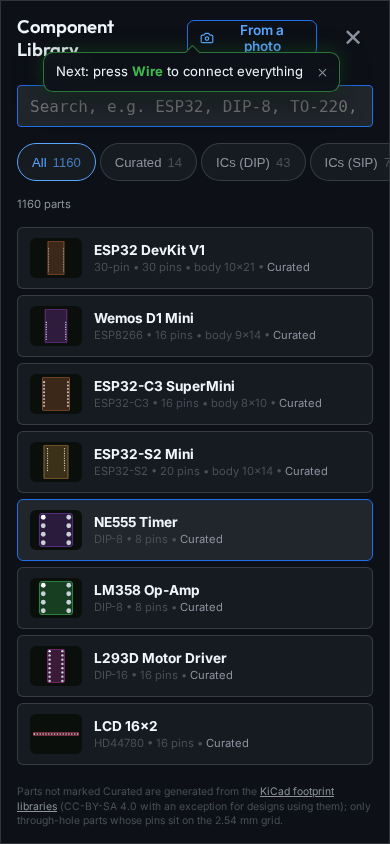
- **Problem**: When a user on mobile opens the Component Library or Photo dialog while on Step 1, the coach mark speech bubble (`.coach-mark`) remains mounted at `z-index: 200` with fixed topbar coordinates. It hovers directly on top of the modal header, search bar, and buttons, intercepting touches and obscuring content.
- **Root Cause**: `CoachMark` in `Topbar.jsx:748` does not check whether a modal or drawer is active before rendering into `document.body`.

### Bug 2: Board Renders Tiny (Not Fitted) on Mobile Initial Load
- **Evidence**: [`docs/ui/bugs/bug2_tiny_board_mobile.png`](bugs/bug2_tiny_board_mobile.png)
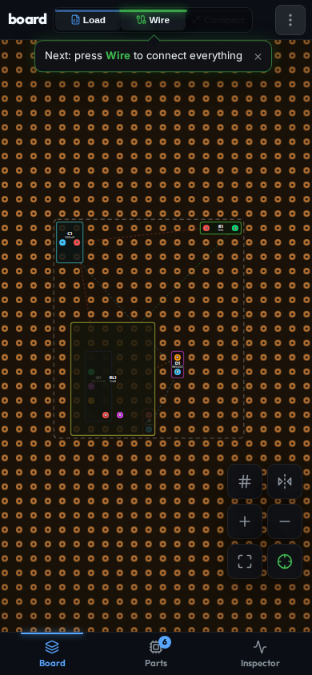
- **Problem**: On phones (e.g. 390x844), loading an example circuit causes the board to render as a tiny cluster in the center of the screen, surrounded by empty perfboard holes.
- **Root Cause**: `fitToBoard` in `PcbCanvas.jsx` calculates initial zoom assuming desktop 16:9 canvas proportions. On tall vertical mobile screens, the zoom calculation fits the board to the horizontal width without filling the vertical viewport, requiring repeated manual pinch-zooming.

### Bug 3: Double Backdrop Filter Compounding in Photo Dialog
- **Evidence**: [`docs/ui/bugs/bug3_double_backdrop.png`](bugs/bug3_double_backdrop.png)
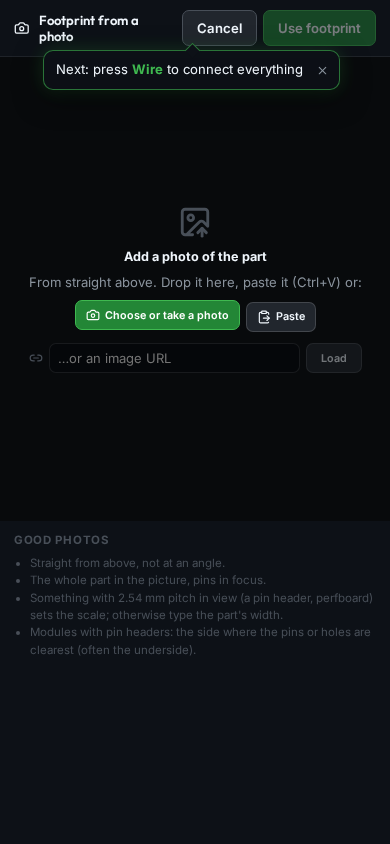
- **Problem**: Opening "From a photo" from the Component Editor mounts `PhotoFootprintOverlay` directly inside `CompEditorOverlay`. Both components render an `.overlay-bg` with `rgba(0,0,0,0.7)` and `backdrop-filter: blur(4px)`.
- **Root Cause**: The two stacked semi-transparent backdrops compound into an almost pitch-black overlay, and coach marks or tooltips get trapped between stacking contexts.

---

## 6. The Canonical Standard: Unifying to the Loved Desktop View

Florian and users explicitly appreciate the **desktop landing view** (`Topbar.jsx`, `SidebarLeft.jsx`, `SidebarRight.jsx`, `PcbCanvas.jsx`). The standard must not alter the landing view; rather, all sub-menus, dialogs, and overlays must be brought into alignment with this canonical aesthetic.

### 6.1 Canonical Specifications
1. **Buttons**:
   - Standard control button: **34px height**, **8px border-radius**, `var(--bg4)` background, `1px solid var(--border)` border, font Outfit 13px / 0.82em, weight 600.
   - Primary affirmative button: **34px height** (dialogs: **38px** desktop, **44px** mobile), `var(--grn)` background, `1px solid var(--grn-bright)` border, white bold text.
   - Danger button: `rgba(248, 81, 73, 0.1)` background, `1px solid rgba(248, 81, 73, 0.25)` border, `var(--err-bright)` text.
2. **Icon Buttons**:
   - Standard: **32px × 32px** (desktop) / **44px × 44px** (mobile), **8px border-radius**, `var(--bg3)` background, 16px Lucide SVG icon.
3. **Segmented Controls**:
   - Standard: **8px outer radius**, `var(--bg0)` background, `1px solid var(--border)`, 2px inner padding; **6px pill radius**, `var(--blu)` active background, white bold text.
4. **Inputs**:
   - Standard: **34px height** (desktop) / **40px** (mobile), **6px border-radius**, `var(--bg0)` background, `1px solid var(--border)` border, focus outline `var(--blu-bright)`.
5. **Dialog Shells**:
   - Standard: **14px border-radius**, `1px solid var(--border2)` border, `var(--bg2)` background, unified header with title + Lucide `<X size={18} />` close button, and standard footer action row (Cancel on left, Primary CTA on right).

### 6.2 Token Translation Table

| Element Property | Current Divergent Values in Code | Proposed Canonical Token | Canonical Value |
| :--- | :--- | :--- | :--- |
| Button Height (sm) | 24px (`.ce-add`), 28px (`.lib-photo`), 30px (`.ce-btn`) | `--btn-h-sm` | `28px` |
| Button Height (md) | 32px (`.rc-btn`), 34px (`.tbtn`) | `--btn-h-md` | `34px` |
| Button Height (lg/CTA) | 38px (`.pb-btn-glass`), 40px (`.ex-btn`), 42px (`.c-btn`) | `--btn-h-lg` | `38px` (desktop) / `44px` (mobile) |
| Border Radius (sm) | 4px (`.copy-btn`), 5px (`.edit-mini-btn`) | `--radius-sm` | `6px` |
| Border Radius (md) | 6px (`.rc-btn`), 7px (`.ce-btn`, `.lib-photo`), 8px (`.tbtn`) | `--radius-md` | `8px` |
| Border Radius (lg) | 10px (`.c-btn`, `.mas-btn`), 12px (`.confirm-modal`) | `--radius-lg` | `12px` |
| Border Radius (modal) | 12px, 14px (`.ce-modal`), 16px (`.lib-modal`, `.export-modal`) | `--radius-xl` | `14px` |
| Primary Green Color | `#238636`, `var(--grn)`, `#2a9a40` (hover), `#3fb950` | `--ui-primary` | `var(--grn)` / hover: `var(--grn-bright)` |
| Danger Red Color | `#f85149`, `var(--err-bright)`, `var(--red)` | `--ui-danger` | `var(--err-bright)` |
| Brand Accent Color | `#1f6feb`, `var(--blu)`, `var(--blu-bright)` | `--ui-accent` | `var(--blu-bright)` |
| Section Header Font | Outfit 1.25em, Inter 0.85em, var(--fs-xs) 700, 0.65rem 800 | `--fs-label` | `11px`, 700, uppercase, `letter-spacing: 0.06em` |
| Standard Input Height | 26px, 28px, 30px, 34px | `--input-h` | `34px` (desktop) / `40px` (mobile) |

---

## 7. Refined Modularization Plan: `src/components/ui/`

To resolve these inconsistencies without disturbing the desktop landing view, we propose creating a shared UI primitive library in `src/components/ui/` and migrating the components in strict phases.

### 7.1 Proposed Component Primitives

1. **`Button.jsx`**:
   - Props: `variant` (`'primary' | 'secondary' | 'ghost' | 'danger' | 'accent'`), `size` (`'sm' | 'md' | 'lg'`), `icon`, `disabled`, `loading`, `fullWidth`.
   - Incorporates standardized `:hover`, `:active`, and `:focus-visible` styling.
2. **`IconButton.jsx`**:
   - Props: `icon`, `size` (`'sm' (24px) | 'md' (32px) | 'lg' (40px/44px)`), `title`, `aria-label`, `danger`.
3. **`ModalShell.jsx`**:
   - Compound component: `ModalShell`, `ModalShell.Header`, `ModalShell.Body`, `ModalShell.Footer`.
   - Handles backdrop blur, portal mounting, click-outside dismissal, `Escape` key listeners, and mobile sheet transitions.
4. **`SegmentedControl.jsx`**:
   - Props: `value`, `onChange`, `options: Array<[val, label]>`, `disabled`.
   - Replaces `.bv-seg`, `.ce-seg`, and `.ex-seg`.
5. **`TextInput.jsx` / `NumberInput.jsx`**:
   - Unified input styling with consistent heights, borders, focus outlines, and label integration.
6. **`Checkbox.jsx`**:
   - Accessible, custom styled 16px square indicator with checkmark SVG.
7. **`SectionHeader.jsx`**:
   - Standard uppercase category label with consistent typography and tracking.

### 7.2 Phased Migration Order & Verification Strategy

| Phase | Target Components | Scope of Changes | Verification Strategy |
| :--- | :--- | :--- | :--- |
| **Phase 1: Foundation** | `src/index.css`, `src/components/ui/*` | Add design tokens to `index.css`; implement primitive components in `src/components/ui/`. | Zero changes to existing components. Desktop visual regression: 100% bitwise match. |
| **Phase 2: Leaf Dialogs** | `ConfirmOverlay.jsx`, `PromptOverlay.jsx`, `ResultCard.jsx` | Migrate to `ModalShell` and `Button`. Fix Bug 1 (hint toast suppression when dialogs open). | Screenshot diff on Confirm, Prompt, and ResultCard. Verify Escape and close button behaviors. |
| **Phase 3: Catalog Dialogs** | `ExportOverlay.jsx`, `LibraryOverlay.jsx`, `ExamplesOverlay.jsx` | Standardize headers, category chips, and footers. Adopt `SegmentedControl` and `Button`. Add missing close button to Examples. | Screenshot diff on Export, Library, and Examples. Verify print/SVG generation remains intact. |
| **Phase 4: Component & Photo Editors** | `CompEditorOverlay.jsx`, `PhotoFootprintOverlay.jsx` | Move primary actions from header to standard footer. Resolve Bug 3 (double backdrop nesting). Adopt `SegmentedControl` and `Input`. | Verify pin editing, canvas interaction, and PR #21 photo footprint generation workflows. |
| **Phase 5: Shell Sidebars & Topbar** | `SidebarLeft.jsx`, `SidebarRight.jsx`, `Topbar.jsx` | Align sidebar action buttons (`.cc-btn`, `.tplbtn`) and mobile action sheet (`.mas-btn`) with `Button` variants. Resolve Bug 2 (canvas mobile fit). | Final full-suite Playwright test run across all 21 desktop and mobile states. |

---

## 8. Summary of Top 10 Inconsistencies

1. **Button Height and Radius Fragmentation**: 16 different button classes with heights jumping between 24px, 28px, 30px, 32px, 34px, 38px, 40px, 42px, and 44px; radii jumping between 4px, 5px, 6px, 7px, 8px, and 10px.
2. **Missing Focus Accessibility Across the Entire App**: No buttons or controls have `:focus-visible` styling except `.bv-switch`. Tab navigation is completely blind.
3. **Inverted Action Button Placement**: `CompEditorOverlay` and `PhotoFootprintOverlay` place primary actions in the header; `ConfirmOverlay` and `ExportOverlay` place actions in the footer; `PromptOverlay` uses a full-width bottom CTA.
4. **Three Incompatible Boolean Toggle Conventions**: BoardSettings uses an iOS-style sliding switch (`.bv-switch`), ExportOverlay uses a native browser checkbox (`.ex-check`), and PhotoFootprintOverlay uses a third checkbox (`.pf-check`).
5. **Scattered `<style>` Injection**: 16 individual `<style dangerouslySetInnerHTML>` blocks inject conflicting CSS directly into the DOM tree on render rather than referencing unified classes in `index.css`.
6. **Input Height and Font Mismatches**: Inputs range from 26px to 36px in height with varying padding and font families (Outfit vs Inter vs Consolas vs JetBrains Mono).
7. **Dialog Header and Close Button Discrepancies**: ExamplesOverlay and ExportOverlay completely lack top-right close buttons; Confirm and Prompt use text glyph `✕`; Library, Mobile Sheet, and Topbar use Lucide SVG `<X />`.
8. **Inconsistent Dismissal Mechanics**: `Escape` key closes some dialogs (Examples, Library, Confirm, Export) but does NOT close `CompEditorOverlay`. Clicking outside closes some dialogs but is blocked in others.
9. **Segmented Control Duplication**: Three separate components (`.bv-seg`, `.ce-seg`, `.ex-seg`) implement segmented radio buttons with divergent radii and paddings.
10. **Layering and Fit Bugs on Mobile**: The 'Next: press Wire' hint toast floats over open modals (`bug1_hint_over_dialog.png`); the board renders tiny on mobile initial load (`bug2_tiny_board_mobile.png`); and the photo editor suffers from double backdrop stacking (`bug3_double_backdrop.png`).
